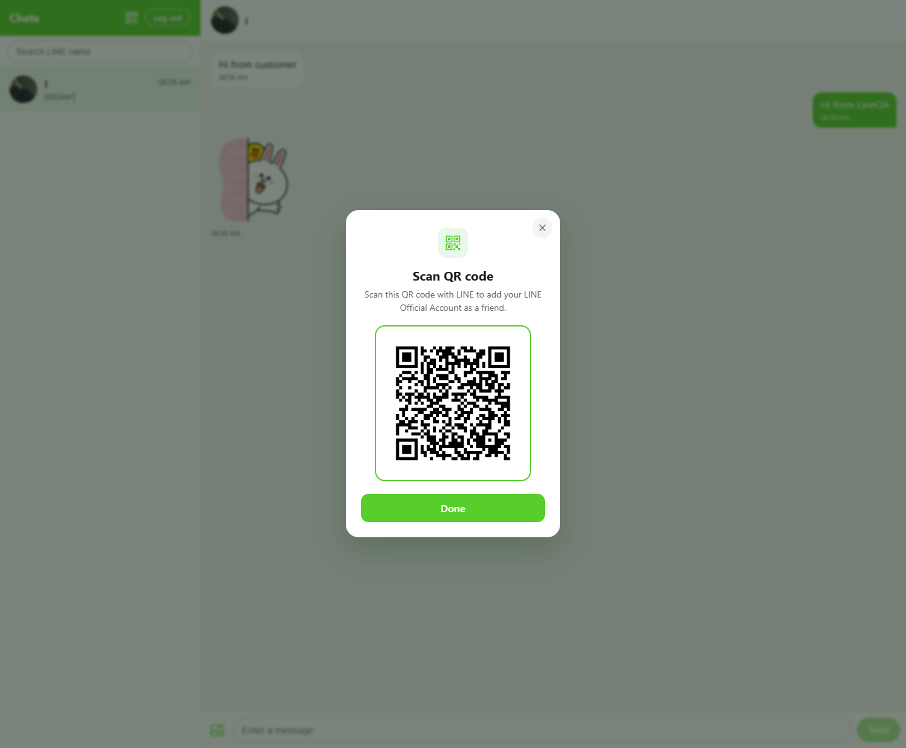
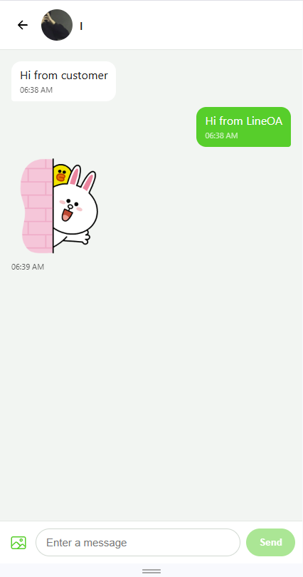

# Webchat LINE OA

A web inbox for a LINE Official Account, built with Next.js. Messages that customers send to the OA appear in the browser, and replies sent from the web are delivered to them in LINE.

# Project now deployed at
```
https://web-chat-jet.vercel.app/
```


## Features

- Receive and reply to LINE messages in real time
- Text, LINE emoji, stickers and images
- Conversation list with unread badges and search by LINE name
- New friends appear as soon as they add the OA; blocked users are marked and replies are disabled
- QR code dialog for adding the OA as a friend
- Responsive layout for desktop and mobile

## Tech stack

- Next.js 15 (App Router, route handlers) with React 19 and TypeScript
- LINE Messaging API (webhook, push, profile, content and mark-as-read)
- Upstash Redis for storage on Vercel, with an in-memory fallback for local development
- axios, Ionicons

## Run project

1. Install dependencies and create the env file:

   ```
   npm install
   copy .env.example .env.local
   ```

2. Fill in `.env.local`:

3. Start the app and expose it with ngrok:

   ```
   npm run dev
   ngrok http 3000
   ```

4. In the LINE Developers Console, set the Webhook URL to `https://<your-ngrok-url>/api/line/webhook`, click **Verify**, and turn on **Use webhook**.

## Deploy to Vercel

1. Import the repository in Vercel and add the env vars above (except `PUBLIC_BASE_URL`).
2. Connect an Upstash Redis database from the **Storage** tab, then redeploy.
3. Set the LINE Webhook URL to `https://<your-app>.vercel.app/api/line/webhook`.

## Responsive Design

| Desktop | Mobile |
|---|---|
|  |  |
